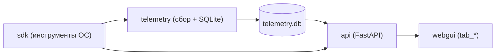

# 🪟 AI Windows Diagnostic & Administration Center

Интеллектуальный центр диагностики, аудита, оптимизации и безопасного администрирования Windows на базе низкоуровневых интерфейсов WinAPI/WMI/PowerShell и аналитического слоя AI (Gemini / Foundry / Ollama / Local).

---

## 💡 Концепция и Архитектурный принцип

> **Низкоуровневые системные интерфейсы (WinAPI, WMI/CIM, Event Log, Registry, Services, Task Scheduler, PnP/DriverStore, Defender, PowerShell) собирают факты, а модель занимается корреляцией, диагностикой, расчётом рисков и формированием безопасных рекомендаций, не получая права на неконтролируемые деструктивные изменения.**

---

## 🏛️ Архитектура системы

Вокруг трёх основных рабочих модулей строится весь проект:

| Модуль | Путь | Роль |
|---|---|---|
| **SDK** | [`sdk/`](sdk/README.md) | Инструменты работы с ОС: FFI-биндинги Win32, SafeOps, ядро аудита, 31 доменная подсистема |
| **Телеметрия** | [`telemetry/`](telemetry/README.md) | Служба сбора метрик и событий, единственный писатель в `telemetry.db` |
| **Веб-интерфейс / API** | [`api/`](api/README.md) | FastAPI-сервер, роутеры и WebGUI (вкладки `tab_*`) |

```
apps/windows/
├── sdk/            # Слой инструментов ОС (native → drivers → features → core → modules)
├── telemetry/      # Сбор, буферизация, SQLite-хранилище, Windows Service (AITelemetry)
├── api/            # FastAPI: server.py, routers/, services/, webgui/
├── wikillm/        # База знаний WikiLLM (4-уровневое разрешение, FTS5, AST-индексатор)
├── ai/             # AI-диагност, анализатор первопричин, промпты, tool_engine
├── ai_instruments/ # Реестр ИИ-инструментов (models, service, storage)
├── analytics/      # Аналитический слой над telemetry.db (запросы, отчёты, инциденты)
├── commands/       # Каталог команд настроек Windows
├── contracts/      # Pydantic-контракты (ai, audit, enums, hardware, telemetry)
├── db/             # Адаптер БД (db_adapter.py)
├── log_intelligence/, prompts/   # Документация по анализу логов и промптам
├── __main__.py, main.py, cli.py, tui.py   # Точки входа (python -m apps.windows)
└── router.py, system_inspector_router.py  # REST-роутеры верхнего уровня
```

### Поток данных



Подробности по каждому модулю — в их README.

---

## 📂 Разделение подсистем: `sdk/core` vs `sdk/modules`

Архитектура `apps/windows` строго разделена по уровню ответственности:

### 1. `apps/windows/sdk/core` — Ядро, инфраструктура и сквозная оркестрация
Содержит **общие фундаментальные механизмы, движки анализа, семантические реестры и сквозные аудиты**, используемые всей системой и AI-агентами:
* **Семантический реестр системных команд (`windows_command_registry.json` / `System32Catalog`):**
  - Полный семантический каталог 149 штатных системных утилит Windows (`%SystemRoot%\System32`) по 66 доменным категориям.
  - Градации уровней риска (`TelemetryTier`: `OBSERVE`, `DIAGNOSE`, `CONTROL`, `ADMIN`, `DESTRUCTIVE`, `RECOVERY`) и уровней привилегий (`STANDARD`, `ADMIN`, `SYSTEM`).
  - Сопоставление CLI-утилит с их низкоуровневыми эквивалентами в PowerShell, WMI/CIM, Win32 API, Native NT API, COM и ETW-провайдерах.
  - Служит защитным барьером (Safety Guardrails) и справочником для AI-интерпретатора и REST API (`/api/v1/system32/*`).
  - Генерируется через [`build_command_registry.py`](apps/windows/sdk/core/build_command_registry.py).
* **Движки анализа и диагностики:** `root_cause_engine.py`, `correlation_engine.py`, `diagnostics.py`.
* **Сквозной контур безопасности и выполнения:** `safe_executor.py`, `agent_loop.py`, `atomic_capabilities.py`.
* **Динамический реестр инструментов для AI-агентов:** `apps/windows/sdk/core/tools` (`dynamic_factory.py`, `registry.py`, `system_tools.py`).
* **Стандартизированные коллекторы аудита:** `apps/windows/sdk/core/audits` (14 унифицированных коллекторов: `CleanCollector`, `DriverCollector`, `SecurityCollector`, `StorageCollector`, `IntegrityCollector` и др.).

### 2. `apps/windows/sdk/modules` — Функциональные доменные подсистемы
Содержит **изолированные тематические подсистемы (мини-приложения/микромодули)**, каждое из которых отвечает за конкретную предметную область Windows и обычно имеет собственный `router.py`, `tui.py`, `core/`, `models.py` и `tests/`:
* **Оборудование и сеть:** `hardware` (GPU Prober, Hardware Sensors), `network` (LAN Scanner, Speedtest, Network Usage).
* **Диски и хранилище:** `storage_manager` (клонирование, экспресс-бенчмарк DiskSpd, низкоуровневые сенсоры накопителей).
* **Системное администрирование:** `services_manager`, `task_scheduler`, `process_manager`, `firewall_manager`, `defender`, `registry`, `startup`.
* **Резервное копирование и целостность:** `system_checkpoints`, `boot_recovery`, `backup_manager`, `servicing_integrity`.

### 📊 Сравнительная таблица

| Критерий | `sdk/core` | `sdk/modules` |
| :--- | :--- | :--- |
| **Назначение** | Инфраструктура, мета-анализ, агентные циклы, сквозной аудит | Самодостаточные доменные утилиты управления конкретными функциями ОС |
| **Структура** | Единый фреймворк классов, инструментов и базовых моделей | Набор независимых пакетов (в каждом `router.py`, `tui.py`, `core/`, `tests/`) |
| **Зависимости** | Базовый слой; импортируется модулями и API | Использует WinAPI/FFI и спец. утилиты; передает данные ядру и телеметрии |
| **Работа с БД** | Не пишет в БД напрямую (только через слой телеметрии) | **Никогда самостоятельно не пишет в `telemetry.db`** |

### 🔄 Однонаправленный конвейер сбора телеметрии
В системе действует строгое правило сбора телеметрии:
$$\text{[телеметрия]} \longrightarrow \text{[внутренние модули apps/windows]} \longrightarrow \text{[телеметрия]} \longrightarrow \text{[бд telemetry.db]}$$

1. **Слой телеметрии** (`apps/windows/telemetry`) запрашивает данные у внутренних модулей (`hardware`, `network`, `storage_manager` и др.).
2. **Внутренние модули** выполняют опрос ОС/оборудования и возвращают чистые структуры данных/модели. Они **не имеют прямых зависимостей от `TelemetryStorage` и не пишут в базу данных**.
3. **Слой телеметрии** агрегирует полученные метрики и централизованно сохраняет их в `telemetry.db` через `TelemetryStorage`.

---

## 🚀 Режимы работы (Diagnostic Modes)

1. **`Quick Health Check` (`--mode quick`)**: Быстрая проверка ключевых параметров за 3 секунды (CPU/RAM/Диск, критические ошибки логов, UAC, Defender).
2. **`Full Deep Audit` (`--mode full`)**: Глубокий аудит по всем 15 доменам системы с расчётом **Health Score (0-100)** и сводным отчетом.
3. **`Security & Persistence Audit` (`--mode security`)**: Проверка защитных механизмов, UAC, открытых портов, подозрительных задач планировщика и персистентности.
4. **`Performance Bottleneck Analysis` (`--mode performance`)**: Выявление ресурсоемких процессов, оптимизация автозагрузки и параметров электропитания.
5. **`Driver Store & Hardware Audit` (`--mode drivers`)**: Поиск PnP ошибок (Code 10/43), инвентаризация и очистка устаревших версий пакетов в `DriverStore`.
6. **`Post-Install System Audit` (`--mode postinstall`)**: Комплексный аудит готовности рабочей станции после чистой установки Windows.
7. **`Root-Cause Investigator` (`--investigate "<симптом>"`):**
   - Пользовательский ввод (напр. *"Компьютер начал тормозить после установки программы X"*).
   - Построение цепочки расследования: Программа → Службы → Автозагрузка → Задачи → Драйверы → Нагрузка → Журналы.
   - Вывод: **Гипотеза + Доказательства + Уровень уверенности + Безопасный план устранения**.

---

## 🔒 Протокол безопасности SafeOps

- **Read-Only по умолчанию:** Любой аудит и диагностика абсолютно пассивны и не изменяют систему.
- **Dry-Run симуляция:** Любое действие (очистка, отключение задачи/службы) сначала рассчитывает освобождаемое место и потенциальные эффекты.
- **Классификация рисков:**
  - 🟢 `Safe`: Очистка `%TEMP%`, кэша браузера, корзины (выполняется свободно).
  - 🟡 `Caution`: Отключение автозагрузки, удаление старых пакетов DriverStore (требует подтверждения пользователя).
  - 🔴 `Critical`: Изменение системных служб, параметров реестра ядра, восстановление компонентов — требует прав администратора и создания точки отката.

---

## 💻 Использование CLI

```powershell
# Быстрая проверка здоровья системы
python -m apps.windows --mode quick

# Полный глубокий аудит системы
python -m apps.windows --mode full

# Расследование первопричины сбоя по симптому
python -m apps.windows --investigate "Компьютер начал тормозить после установки программы"

# Вывод в формате JSON (для интеграций и RAG)
python -m apps.windows --mode full --json

# Запуск интерактивного TUI Dashboard
python -m apps.windows --tui

# Запуск интерактивного TUI монитора оборудования (Hardware Monitor)
python -m apps.windows --hardware

# Получение аппаратного снимка в формате JSON
python -m apps.windows --hw-json

# Запуск интерактивного монитора системных логов
python -m apps.windows --logs --channel System

# Запуск автономного REST API сервера
python -m apps.windows --server --port 8105
```

---

## 🌐 FastAPI REST API

| Метод | Эндпоинт | Описание |
|---|---|---|
| `GET` | `/api/windows/health?mode=quick` | Сводная оценка Health Score (0-100) |
| `GET` | `/api/windows/hardware/monitor` | Полный слепок аппаратного мониторинга (CPU, RAM, GPU, Диски, Сеть, Датчики) |
| `GET` | `/api/windows/hardware/monitor/summary` | Сводка здоровья и пороговых предупреждений оборудования |
| `GET` | `/api/windows/hardware/sensors` | Показания всех активных датчиков температуры, вентиляторов и вольтажа |
| `GET` | `/api/windows/hardware/gpu` | Телеметрия видеокарт NVIDIA / AMD / Intel / WMI |
| `GET` | `/api/windows/hardware/smart` | Диагностика накопителей и S.M.A.R.T. |
| `GET` | `/api/windows/hardware/audit` | Аппаратный аудит через CPU-Z / AIDA64 / WMI |
| `POST` | `/api/windows/benchmark/stress` | Стресс-тест CPU / GPU с защитой от перегрева |
| `GET` | `/api/windows/audit/full` | Полный глубокий отчет по 15 доменам |
| `GET` | `/api/windows/audit/clean` | Аудит кэшей, %TEMP% и корзины |
| `GET` | `/api/windows/audit/performance` | Аудит нагрузки CPU/RAM и автозагрузки |
| `GET` | `/api/windows/audit/drivers` | Аудит PnP устройств и DriverStore |
| `GET` | `/api/windows/audit/software` | Инвентарь установленного ПО и компонентов |
| `GET` | `/api/windows/audit/integrity` | Проверка целостности SFC / DISM / Servicing |
| `GET` | `/api/windows/audit/storage` | Аудит дисков, томов и свободного места |
| `GET` | `/api/windows/audit/security` | Аудит Defender, UAC и персистентности |
| `GET` | `/api/windows/audit/events` | Корреляция системных журналов ошибок |
| `GET` | `/api/windows/audit/processes` | Анализ запущенных процессов |
| `GET` | `/api/windows/audit/services` | Инвентарь служб и поиск осиротевших сервисов |
| `GET` | `/api/windows/audit/tasks` | Аудит планировщика заданий |
| `GET` | `/api/windows/audit/network` | Телеметрия сокетов и открытых портов |
| `GET` | `/api/windows/audit/updates` | Версии ОС и установленные KB |
| `GET` | `/api/windows/audit/baseline` | Аудит эталонного снимка и дрифта |
| `GET` | `/api/windows/audit/postinstall` | Чек-лист готовности после установки ОС |
| `POST` | `/api/windows/investigate` | Расследование симптома (Root-Cause) |
| `POST` | `/api/windows/actions/simulate` | SafeOps Dry-Run симуляция действия |
| `POST` | `/api/windows/actions/execute` | Безопасное выполнение действия (Admin) |
| `POST` | `/api/windows/wikillm/resolve` | 4-уровневое разрешение артефакта (Exact -> FP -> Semantic -> Gemini) |
| `GET` | `/api/windows/wikillm/entities/{key}` | Получение подробных сведений о сущности базы знаний |
| `GET` | `/api/windows/wikillm/search` | Полнотекстовый поиск FTS5 по базе знаний |
| `GET` | `/api/windows/wikillm/stats` | Метрики кэша, статистика хитов L1-L4 и размер хранилища |
| `GET` | `/api/windows/security/status` | Аудит канала Security, права доступа, закладки и статус аудита CommandLine |
| `POST` | `/api/windows/security/collect` | Инкрементальный сбор событий безопасности с фиксацией Bookmark |
| `GET` | `/api/windows/security/events` | Выборка нормализованных событий безопасности с гибкой фильтрацией |
| `GET` | `/api/windows/security/tail` | Мониторинг последних событий безопасности в реальном времени |
| `GET` | `/api/windows/security/failed-logons` | Анализ неудачных попыток аутентификации (Event ID 4625) |
| `GET` | `/api/windows/security/process-creations` | Аудит запусков процессов (Event ID 4688) с PID и командной строкой |
| `GET` | `/api/windows/security/correlation` | Корреляция событий безопасности с телеметрией процессов и всплесками ресурсов |

---

## 🛡️ Инкрементальный сборщик журнала безопасности (Security Event Log Collector)

Встроенный в подсистему телеметрии модуль инкрементального сбора `Security.evtx` решает проблему анализа журналов объемом в миллионы записей:
* **Win32 `wevtapi.dll` Native FFI:** Прямой доступ к событиям через `EvtQuery`, `EvtCreateBookmark`, `EvtUpdateBookmark`, `EvtSeek`, `EvtSubscribe` и `EvtRender` без создания медленных процессов PowerShell.
* **Инкрементальный курсор (Bookmark):** Запоминает последний обработанный `EventRecordID`. При перезапуске читаются только новые записи.
* **Нормализация ключевых Event ID:** 
  - `4688` — создание процессов (PID, Parent PID, CommandLine, User);
  - `4624` / `4625` — успешные и неудачные входы в систему (LogonType, Source IP, Target User);
  - `4698` / `4702` — создание и изменение задач планировщика;
  - `4697` — установка системных служб;
  - `4720–4740` — создание, изменение, отключение и блокировка учетных записей;
  - `1102` — очистка журнала аудита безопасности.
* **Двухуровневое хранилище в `telemetry.db`:**
  - `security_events` — нормализованные данные с B-Tree индексами для мгновенного поиска;
  - `security_events_raw` — исходный XML для аудита и повторного разбора;
  - `security_collector_bookmarks` — персистентное состояние закладки.
* **Корреляция:** Автоматическое сопоставление запусков процессов со снимками телеметрии (всплески CPU > 70%, RAM > 80%, диск, сеть).

---

## 🛠️ Нативный Function Calling и Саморасширяемые инструменты (Self-Extending Tools)

Модуль `apps/windows/sdk/core/tools` реализует передовую архитектуру вызова и синтеза инструментов на лету:

1. **`ToolRegistry` (`registry.py`)**:
   - Централизованный реестр инструментов с формированием схем вызова OpenAPI / Function Calling (`to_function_definition()`).
   - Динамическая регистрация и удаление инструментов без перезапуска сервиса.
2. **`BaseTool` (`base.py`)**:
   - Абстрактный базовый класс для безопасных инструментов с валидацией входных аргументов, структурированным результатом (`ToolExecutionResult`) и оценкой уровней риска (`RiskLevel`).
3. **`WindowsCollectorTool` & `SafePowerShellProbeTool` (`system_tools.py`)**:
   - Встроенные системные инструменты, оборачивающие 15 доменных коллекторов и безопасный PowerShell-зондировщик с жестким SafeOps-фильтром деструктивных инструкций.
4. **`DynamicToolFactory` & `CreateCustomToolMetaTool` (`dynamic_factory.py`)**:
   - **Мета-инструмент `create_custom_tool`**: позволяет языковой модели самостоятельно конструировать новый инструмент под уникальный запрос пользователя, безопасно регистрировать его в runtime, выполнять зондирование хоста и автоматически сохранять переиспользуемый навык в каталог `.skills/`.
5. **`WindowsAgentLoop` (`agent_loop.py`)**:
   - Автономный ReAct / Function Calling цикл принятия решений с потоковой генерацией промежуточных этапов в веб-интерфейс Test Computer (`/tc`).

---

## 🧪 Тестирование

```powershell
pytest apps/windows/telemetry/tests apps/windows/sdk -v   # тесты модулей лежат в tests/ рядом с кодом
```

---

## 📜 Лицензия

© 2026 hypo69. Все права защищены.

**Updated:** 2026-10-31 16:45:00
