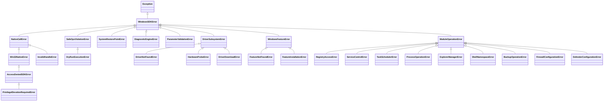

# 🪟 Windows SDK (Software Development Kit)

Единый комплексный SDK для низкоуровневой диагностики, мониторинга, управления оборудованием, безопасного администрирования, SafeOps-оркестрации и типизированной обработки системных исключений Windows в среде **AI-Windows-Admin**.

---

## 🏛️ Архитектура SDK

SDK — один из трёх основных модулей проекта (вместе с [`telemetry`](../telemetry/README.md) и [`api`](../api/README.md)). Слои зависят строго сверху вниз: `modules` → `core` → `features`/`drivers` → `native`/`win32_ffi`.

```
apps/windows/sdk/
├── __init__.py           # Корневой экспорт SDK (WindowsSDK, windows_sdk, подсистемы)
├── client.py             # Фасад WindowsSDK: native / drivers / features / core / modules
├── exceptions.py         # Иерархия типизированных исключений
├── dynamic_runner.py     # Исполнение динамически сгенерированного кода инструментов
├── security_ast.py       # AST-проверка динамического кода (запрещённые конструкции)
├── security_policy.json  # Политика безопасности для security_ast / dynamic_runner
│
├── native/               # [Слой 1] ctypes-биндинги Win32 (см. native/README.md)
│   ├── kernel32.py, advapi32.py, psapi.py, ntdll.py, pdh.py
│   ├── iphlpapi.py, nethelper.py   # Сетевые сокеты и адаптеры
│   ├── scm.py, tasksched.py        # Service Control Manager, Task Scheduler
│   ├── setupapi.py, etw.py         # PnP / DriverStore, ETW
│   └── error.py, error_decoder.py  # Win32Error, расшифровка Win32/NTSTATUS/HRESULT
│
├── win32_ffi/            # Единый пакет FFI-классов (Kernel32API, PsapiAPI, WevtAPI,
│                         #   ServiceControlManager, IPHelperAPI, ...); используется
│                         #   телеметрией (telemetry/win32_ffi — мост на этот пакет)
│
├── drivers/              # [Слой 2] GPU-детектор, каталоги NVIDIA/AMD, загрузчик драйверов
├── features/             # [Слой 3] Windows Optional Features (DISM/PowerShell): manager.py
│
├── core/                 # [Слой 4] Ядро SafeOps, аудит, аналитика, инструменты ИИ
│   ├── safe_executor.py, safe_ops.py   # Dry-Run, оценка риска, точки отката
│   ├── system_restore.py, system_param_manager.py
│   ├── diagnostics.py, correlation_engine.py, root_cause_engine.py
│   ├── process_audit_manager.py, process_activity_engine.py, etw_pipeline.py
│   ├── software_audit.py, software_transparency.py, defender_manager.py
│   ├── atomic_capabilities.py, atomic_models.py, agent_loop.py,
│   │   universal_langchain_agent.py, closed_loop_remediation.py
│   ├── system32_catalog.py, system32_models.py, build_command_registry.py
│   ├── audits/           # 14 унифицированных коллекторов аудита
│   ├── tools/            # ToolRegistry, BaseTool, DynamicToolFactory (см. tools/README.md)
│   └── tool_chains/      # Планирование и запуск цепочек инструментов
│
├── display/              # Конфигурация дисплеев (display_config.py)
├── settings/             # Каталог и resolver настроек Windows, верификация применения
├── shell/                # Конфигурация панели задач (taskbar_config.py)
├── software_scanner/     # Сканер ПО: probes, correlator, orphan_detector, report
│
└── modules/              # [Слой 5] 31 доменная подсистема
```

### Доменные модули (`modules/`)

| Группа | Модули |
|---|---|
| Оборудование и сеть | `hardware`, `network`, `sound`, `performance_tracing`, `extended_inspectors` |
| Диски и бэкапы | `storage_manager`, `backup_manager`, `system_checkpoints`, `boot_recovery`, `servicing_integrity` |
| Безопасность | `defender`, `firewall_manager`, `security_acl`, `accounts_identity`, `event_logs` |
| Администрирование | `services_manager`, `task_scheduler`, `process_manager`, `registry`, `startup`, `sysadmin`, `system_control_center`, `software_manager` |
| Оболочка и UI | `explorer_manager`, `shell_namespace`, `taskbar`, `window_control_plane`, `focus_policy`, `personalization`, `regional` |
| Расследование | `programms_history_deep_researh` (история запуска программ: реестр, артефакты, отчёт) |

Фасад `windows_sdk.modules` лениво отдаёт: `hardware`, `network`, `network_discovery`, `storage`, `defender`, `firewall`, `services`, `task_scheduler`, `registry`, `process_manager`, `taskbar`, `window_control_plane`, `software_scanner`, `regional`. Остальные модули импортируются напрямую из `apps.windows.sdk.modules.<имя>`.

> [!IMPORTANT]
> Модули SDK **не пишут** в `telemetry.db` самостоятельно: сбор и запись идут через слой телеметрии (исключение — узкие хранилища вроде `personalization/store.py`, `core/tool_chains/storage.py`).

---

## ⚠️ Система исключений SDK (Exceptions Hierarchy)

Все сбои и ошибки подсистем строго типизированы и наследуются от базового класса [`WindowsSDKError`](file:///c:/Users/onela/AppData/Local/ai-tc/apps/windows/sdk/exceptions.py#L22-L46):



### Пример обработки исключений:
```python
from apps.windows.sdk.exceptions import (
    WindowsSDKError,
    SafeOpsViolationError,
    AccessDeniedSDKError,
    RegistryAccessError,
)

try:
    windows_sdk.modules.registry.set_value(...)
except AccessDeniedSDKError as err:
    print(f"Требуются права Администратора: {err} (Код: {err.win32_code})")
except SafeOpsViolationError as err:
    print(f"SafeOps отклонил операцию: {err}")
except WindowsSDKError as err:
    print(f"Ошибка Windows SDK: {err}")
```

---

## 🚀 Быстрый старт

### 1. Использование через единый фасад `WindowsSDK`

```python
from apps.windows.sdk import windows_sdk

# Сбор экспресс-сводки состояния системы
health = windows_sdk.get_health_summary()
print(health)

# Получение аппаратного снимка оборудования
hw_snapshot = windows_sdk.modules.hardware.get_snapshot()

# Проверка компонентов Windows Optional Features
features = windows_sdk.features.get_features()
for feat in features[:5]:
    print(f"{feat['FeatureName']}: {feat['State']}")
```

### 2. Прямой импорт специализированных слоев

```python
from apps.windows.sdk.native import Kernel32, WindowsErrorDecoder
from apps.windows.sdk.core import SafeExecutor, WinAPI
from apps.windows.sdk.drivers import GpuHardwareDetector, VendorType

# Детектирование GPU
detector = GpuHardwareDetector()
clean_ver = detector.format_driver_version("32.0.15.6094", VendorType.NVIDIA)
print(f"NVIDIA Version: {clean_ver}")
```

---

## 🔒 Стандарты безопасности SafeOps

Все операции изменения состояния системы в рамках SDK подчиняются строгим правилам:
1. **Dry-Run симуляция**: предварительный расчет последствий перед любым деструктивным действием.
2. **Точки отката**: автоматическое создание точек восстановления `SystemRestore` перед внесением изменений.
3. **Разграничение рисков**: разделение на уровни `Safe` (пассивный аудит / очистка кэшей), `Caution` (отключение автозагрузки), `Critical` (реестр, службы, ядро).

---

**Updated:** 2026-10-31 16:10:00  
**Package:** `apps.windows.sdk`  
**Author:** hypo69
