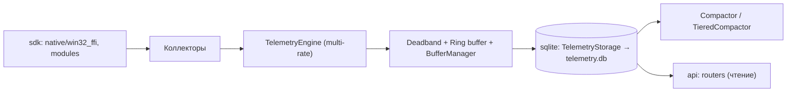

# Подсистема телеметрии Windows (`apps.windows.telemetry`)

Один из трёх основных рабочих модулей проекта (вместе с [`sdk`](../sdk/README.md) и [`api`](../api/README.md)). Отвечает за сбор метрик, событий и инвентаря Windows и является **единственным писателем** в `telemetry.db` (SQLite). SDK-модули и API данные только запрашивают/читают.

Связанные документы: [`CONFIG.md`](CONFIG.md) — справочник `config.json`; [`ABOUT.md`](ABOUT.md) — краткое описание `SystemCollector`; [`sqlite/README.md`](sqlite/README.md) — хранилище; [`TELEMETRY_ROADMAP.md`](TELEMETRY_ROADMAP.md) — план развития.

---

## 🏛️ Архитектура



### Основные компоненты

| Файл | Назначение |
|---|---|
| `main.py` | Точка входа: `--mode minimal/hybrid/full`, `--once`, `--interval`, `--config` |
| `win_service.py`, `ctl.py` | Windows Service `AITelemetry` и консольный контроллер `AITelemetryCtl` |
| `service.py` | `TelemetryLoggerService` — фоновый посекундный сбор с записью в SQLite |
| `telemetry_engine.py` | `TelemetryEngine`: многоскоростное ядро (см. ниже), `DeadbandTracker` |
| `telemetry_config.py` | `TelemetryConfigManager` — загрузка/валидация `config.json`, горячее перечитывание, режимы |
| `sampling_controller.py` | Адаптивная частота: forensic → incident → boot-фазы → monitoring → normal |
| `collector.py` | `SystemCollector` (декомпозирован на `process_metrics`, `network_activity`, `software_info`, `history_mixin`) |
| `hardware_collector.py`, `hardware_tree.py`, `hardware_enricher.py` | PnP/WMI-инвентарь, дерево компонентов, AI-обогащение |
| `sensors.py`, `sensor_collector.py`, `sensor_registry.py` | Датчики температуры, питания, вентиляторов |
| `storage_usage.py` | 4-уровневый стек телеметрии накопителей |
| `security_collector.py`, `security_normalizer.py` | Журнал Security: Bookmark, нормализация событий |
| `power_lifecycle.py`, `failures_analyzer.py`, `incident_detector.py` | Жизненный цикл питания, BSOD/сбои, инциденты |
| `directory_watcher.py`, `file_collector.py` | Файловая активность с привязкой к PID |
| `device_flapping_sensor.py`, `internet_speed.py`, `deep_diagnostics.py` | Периферия, скорость сети, глубокая диагностика |
| `w64_collector.py`, `w64_etw_collector.py` | Низкоуровневые события ядра и ETW |
| `ring_buffer.py`, `telemetry_buffer_manager.py` | Кольцевой буфер и пакетная запись (снижение IOPS) |
| `compactor.py`, `sqlite/tiered_compactor.py` | Rollup временных рядов (таблица `telemetry_rollups`) |
| `catalog/event_catalog.py` | Каталог провайдеров/каналов Event Log по 7 доменам |
| `win32_ffi/` | Мост совместимости → [`apps.windows.sdk.win32_ffi`](../sdk/win32_ffi/README.md) |
| `sqlite/` | Схемы, writer/reader/storage-миксины, дельты, обслуживание |
| `init_db.py` | Проверка и создание структуры БД |
| `tests/` | Тесты (дельты, буфер, режимы, rollup, процессы и др.) |
| `launchers/` | PowerShell: `Install-TelemetryExe.ps1`, `Install-TelemetryTask.ps1`, `Run-Telemetry.ps1`, `Show-StartLog.ps1` |

### Многоскоростное ядро (`multi_rate_engine`)

`TelemetryEngine.start()` запускает независимые циклы:

1. **Realtime tick** (`_main_realtime_tick_loop`) — ~1 с: CPU/RAM/процессы/сокеты (уровень 3).
2. **Adaptive sensors** (`_adaptive_sensors_loop`) — интервал 0.5–30 с с backoff (уровень 2).
3. **Low-frequency** (`_low_frequency_background_loop`) — SMART, батарея, Security, SCM/задачи (уровень 1).
4. **WAL flusher** (`_batch_wal_flusher_loop`) — пакетный сброс буфера в SQLite.

Значения фильтруются `DeadbandTracker` (порог + heartbeat), поэтому в БД попадают только значимые изменения. Статический инвентарь собирается отложенно (`_deferred_static_inventory_task`).

### Режимы телеметрии (`telemetry_mode`)

`audit` · `live_stream` · `both` · `tc` (временный интенсивный режим с таймаутом `tc_mode_timeout_seconds`). Переключаются через `ctl.py mode ...` и API (`router_telemetry_config`).

---

## ▶️ Запуск

```powershell
python -m apps.windows.telemetry.main --mode hybrid      # консоль
python -m apps.windows.telemetry.main --once             # однократный опрос

# Windows Service (права администратора)
.\apps\windows\telemetry\launchers\Install-TelemetryExe.ps1            # сборка + установка + запуск
.\apps\windows\telemetry\launchers\Install-TelemetryExe.ps1 -Status    # также -Stop/-Start/-Restart/-Uninstall

AITelemetryCtl.exe status | start | stop | restart | diagnose | database | mode | audit | security
```

### Каталоги службы

```text
C:\Program Files\AITelemetry\      AITelemetry.exe, AITelemetryCtl.exe, *.dll/*.pyd
C:\ProgramData\AITelemetry\        config\config.json, logs\telemetry.log, data\telemetry.db, cache\, snapshots\
```

---

## 🗄️ Хранилище

Подробно — в [`sqlite/README.md`](sqlite/README.md). Принцип **Change-Only**: пишутся только дельты (`DeltaStateTracker`, `DeltaInventory`, LOCF-восстановление). Основные таблицы: `system_snapshots`, `sensor_polls`, `process_snapshots`, `process_lifecycle_sessions`, `process_file_events`, `power_sessions`, `incidents`, `hardware_components`, `hardware_component_history`, `telemetry_rollups`, плюс таблицы инвентаря, аудита и безопасности (`sqlite/schema_*.py`).

---

**Updated:** 2026-10-31 16:20:00
**Package:** `apps.windows.telemetry`
**Author:** hypo69
