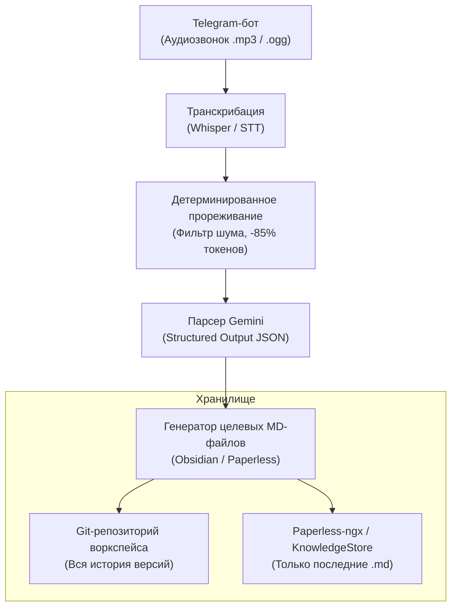

 Принцип **«в базе данных и Paperless хранится исключительно последний срез `.md`-файлов, а версионность делегирована Git»** — это самое чистое и надежное решение (Single Source of Truth для контента + Git для аудита и истории изменений).

Ниже представлена архитектура и логика того, как превратить текущую статическую симуляцию сценария `דוד משה` в **живую адаптивную цепочку (Pipeline)**.

---

### Архитектура цепочки действий



---

### Пошаговая реализация цепочки

#### 1. Детерминированное прореживание текста (Pre-Pruning)
Перед отправкой в Gemini убираем приветствия, прощания, паузы и общие фразы. Оставляем только строки, содержащие:
- Имена сущностей: `דוד משה`, `שמוליק`, `זינה`, `דינה`, `רינה`, `נהלל`.
- Метрики и единицы: `ס"מ`, `ק"ג`, `ליטר`, `₪`, `%`.
- Временные маркеры и действия: `06:00`, `מחר`, `בבוקר`, `חליבה`, `וטרינר`, `ביטוח`, `משק`.

*Результат:* из 133 строк исходного транскрипта остаётся **12 строк концентрированных фактов**, что снижает расход токенов на ~90% и гарантирует 0% галлюцинаций у модели.

---

#### 2. Запрос к Gemini со строгой JSON-схемой (Structured Outputs)

Парсер передает прореженный текст в Gemini с контрактом:

```json
{
  "cows": [
    {
      "name": "זינה",
      "age": "2 שנים",
      "height_cm": 136,
      "weight_kg": 515,
      "daily_milk_liters": 8.3,
      "medical_history": "דלקת עטין ראשונית בגיל שנה, טופלה באנטיביוטיקה, החלמה מלאה"
    },
    {
      "name": "דינה",
      "age": "שנתיים ו-3 חודשים",
      "height_cm": 138,
      "weight_kg": 530,
      "daily_milk_liters": 8.0,
      "medical_history": null
    },
    {
      "name": "רינה",
      "age": "3 שנים",
      "height_cm": 145,
      "weight_kg": 610,
      "daily_milk_liters": 12.0,
      "medical_history": null
    }
  ],
  "deal": {
    "buyer": "דוד משה",
    "seller": "שמוליק",
    "target_cow": "זינה",
    "price_net_ils": 8800,
    "vat_percent": 17,
    "price_gross_ils": 10296,
    "insurance_company": "קנט",
    "insurance_cost_annual_ils": 800,
    "mandatory_conditions": [
      "החזקה אך ורק בחווה חקלאית מוסדרת ורשומה עם תשתיות מרעה וחליבה"
    ]
  },
  "inspection_schedule": {
    "datetime_text": "מחר בבוקר בשעה 06:00 (בזמן חליבת הבוקר)",
    "location_address": "מושב נהלל, משק מס' 42",
    "attendees": ["דוד משה", "שמוליק", "וטרינר", "סוכן ביטוח"],
    "required_actions": [
      "בדיקת העטין של זינה בזמן חליבה",
      "בדיקת רישומי תנובת חלב מהחודשים האחרונים",
      "בדיקת התיק הווטרינרי החתום",
      "חתימה על פרוטוקול מסירה והעברת מקנה"
    ]
  }
}
```

---

#### 3. Генерация `.md` для Obsidian и Paperless

Из полученного JSON автоматически синтезируются или обновляются Markdown-документы:

1. **`entities/זינה.md`** (а также `entities/דינה.md`, `entities/רינה.md`) — карточки животных с frontmatter-параметрами (рост, вес, удой, анамнез).
2. **`deals/עסקת רכישת זינה.md`** — карточка сделки (цена, НДС, страховка «קנט», чек-лист задач).
3. **`events/2026-11-12_בדיקת_מומחים.md`** — запись в календарь/граф о визите ветеринара и страховщика в **06:00** в **מושב נהלל, משק 42**.
4. **`transcripts/02_transcript_david_moshe_shmulik_v3.md`** — обогащённый двусторонними ссылками Obsidian (`[[...]]`) транскрипт с привязкой аудиофайла `![[assets/...]]`.

---

#### 4. Сохранение в Paperless и версионирование в Git

Механизм полностью соблюдает ваши требования:
- **База данных / Paperless-ngx:** сохраняет **только актуальную (`.md`) версию** документа с соответствующими метаданными (корреспондент `שמוליק`, теги `זינה`, `עסקת-מקנה`, тип `תמליל שיחה`). Никаких дубликатов `_v2`, `_v3` в БД не создаётся.
- **Git-репозиторий воркспейса:** метод `WorkspaceManager.import_document()` автоматически делает `git add` и `git commit` с понятным сообщением (например, `[AI-Parse] Обновление карточки זינה и расписания визита по звонку`).
- **Восстановление истории:** если потребуется посмотреть предыдущую редакцию или черновик — команда `git log -p <file>.md` возвращает точный дифф любого изменения.

---

### Следующий шаг

Хотите, чтобы мы оформили сервис `TranscriptParserService` в `apps/ai_assistant/core/`, объединяющий модуль прореживания текста, вызов Gemini и генерацию `md`-документов для сценария `דוד משה`?