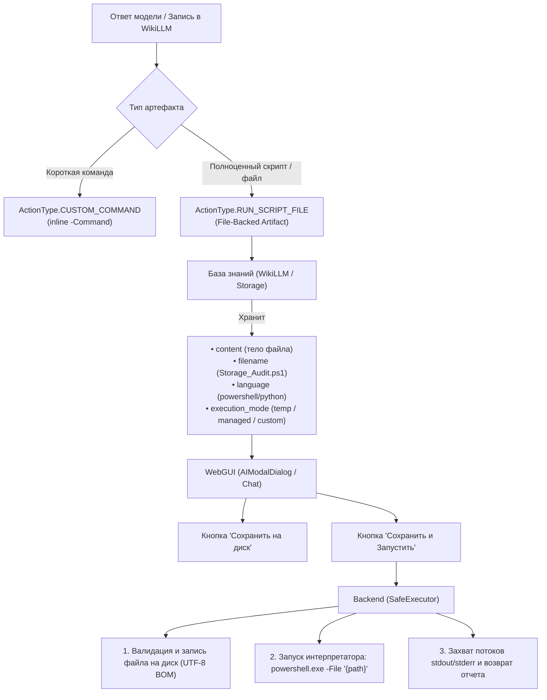

Для решения этой задачи требуется переход от парадигмы **«выполнение inline-строки через `-Command`»** к архитектуре **«декларативного файлового артефакта (File-backed Script Execution)»**.

### Почему текущий подход со строковыми командами дает сбой:
1. **Специфика PowerShell CLI:** При вызове `powershell.exe -Command "<код>"` движок парсит аргумент в интерактивном режиме (как в REPL-консоли). Если в начале скрипта идет блок справки `<# ... #>`, парсер закрывает первое выражение, а следующий атрибут `[CmdletBinding()]` считает невалидным (`Unexpected attribute`).
2. **Ограничение Windows API:** Длина командной строки процесса (`CreateProcessW`) ограничена **8191 символом** (для `cmd.exe`) или **32767 символами** (для Win32 API). Большие скрипты просто не помещаются в аргументы.
3. **Контекст окружения:** Теряются переменные скриптового контекста (`$PSScriptRoot`, `$MyInvocation.MyCommand.Path`), необходимые для относительных путей.

---

## 🏛️ Архитектурная стратегия: «File-Backed Action Lifecycle»

Стратегия охватывает 4 уровня: **модели базы знаний**, **контракты SafeOps**, **бэкенд выполнения** и **WebGUI-интерфейс**.



---

### 1. Расширение модели данных и Базы Знаний (WikiLLM)

В контракты системы (`apps/windows/contracts/enums.py` и `audit.py`), а также в сущности WikiLLM (`models.py`) добавляется тип действия `RUN_SCRIPT_FILE` и метаданные файлового артефакта:

```python
# apps/windows/contracts/enums.py
class ActionType(str, Enum):
    # ... существующие типы ...
    CUSTOM_COMMAND = "custom_command"
    RUN_SCRIPT_FILE = "run_script_file"  # Новый тип: запуск через создание файла


class ScriptStoragePolicy(str, Enum):
    TEMP = "temp"          # Временный изолированный файл (автоочистка после исполнения)
    MANAGED = "managed"    # Каталог базы знаний (%LOCALAPPDATA%/AI-TC/scripts/...)
    USER_PATH = "user_path"# Путь, явно указанный пользователем
```

В структуру `RemediationAction` и `ResolutionAction` добавляются поля:
```python
@dataclass
class RemediationAction:
    action_id: str
    action_type: ActionType
    title: str
    description: str
    target: str
    risk: RiskLevel
    
    # === Новые атрибуты файлового выполнения ===
    file_content: Optional[str] = None          # Полное содержимое файла
    suggested_filename: str = "script.ps1"      # Рекомендуемое имя файла
    language: str = "powershell"                # Язык (powershell, python, batch)
    storage_policy: ScriptStoragePolicy = ScriptStoragePolicy.TEMP
    custom_destination_path: Optional[str] = None # Пользовательский путь сохранения
    script_arguments: str = ""                  # Аргументы запуска скрипта
    cleanup_after_run: bool = False             # Удалять ли файл после выполнения
```

---

### 2. Исполнительный слой (SafeExecutor & DynamicRunner)

В `apps/windows/sdk/core/safe_executor.py` добавляется обработчик `_execute_script_file`:

```python
def _execute_script_file(self, action: RemediationAction) -> None:
    """Безопасная материализация файла на диске и запуск через интерпретатор."""
    if not action.file_content:
        action.executed = True
        action.success = False
        action.error_message = "Отсутствует содержимое файла (file_content)."
        return

    # 1. Определение целевого пути
    if action.storage_policy == ScriptStoragePolicy.USER_PATH and action.custom_destination_path:
        target_path = Path(action.custom_destination_path).resolve()
    elif action.storage_policy == ScriptStoragePolicy.MANAGED:
        target_path = Path(os.environ.get("LOCALAPPDATA", "C:/Temp")) / "AI-TC" / "scripts" / action.suggested_filename
    else:
        # TEMP: изолированная папка для запусков
        session_dir = Path(os.environ.get("TEMP", "C:/Temp")) / "ai_tc_runs" / str(uuid.uuid4())[:8]
        session_dir.mkdir(parents=True, exist_ok=True)
        target_path = session_dir / action.suggested_filename

    target_path.parent.mkdir(parents=True, exist_ok=True)

    # 2. Сохранение файла на диск с корректной кодировкой (UTF-8 with BOM для Windows PowerShell)
    encoding = "utf-8-sig" if action.language.lower() == "powershell" else "utf-8"
    target_path.write_text(action.file_content, encoding=encoding)

    # 3. Формирование команды выполнения через -File (не -Command!)
    if action.language.lower() in ("powershell", "ps1"):
        cmd = [
            "powershell.exe",
            "-NoProfile",
            "-ExecutionPolicy", "Bypass",
            "-File", str(target_path)
        ]
        if action.script_arguments:
            cmd.extend(action.script_arguments.split())
    elif action.language.lower() in ("python", "py"):
        cmd = ["python", str(target_path)]
    else:
        cmd = [str(target_path)]

    # 4. Выполнение и перехват вывода
    try:
        res = subprocess.run(cmd, capture_output=True, text=True, timeout=120)
        action.executed = True
        action.success = (res.returncode == 0)
        action.details = {
            "stdout": res.stdout,
            "stderr": res.stderr,
            "exit_code": res.returncode,
            "saved_file_path": str(target_path)
        }
        if res.returncode != 0:
            action.error_message = res.stderr.strip() or res.stdout.strip()
    finally:
        # 5. Очистка, если требовался одноразовый запуск
        if action.cleanup_after_run and action.storage_policy == ScriptStoragePolicy.TEMP:
            try:
                target_path.unlink(missing_ok=True)
            except Exception:
                pass
```

---

### 3. Инструкции и контракт ответа ИИ-помощника

Чтобы модель возвращала данные в предсказуемом формате для базы знаний, в системные промпты диагностики (`diagnostics_prompt_manager.py`) внедряется структурированная схема возврата действий:

```json
{
  "action_type": "run_script_file",
  "title": "Аудит дисковой подсистемы и BitLocker",
  "suggested_filename": "Storage_Audit.ps1",
  "language": "powershell",
  "target_path": "C:\\KB\\Storage_Audit.ps1",
  "run_arguments": "-OutputPath C:\\KB\\Storage_Audit_Report.json",
  "file_content": "<#\\n.SYNOPSIS...#>[CmdletBinding()]...",
  "risk": "safe"
}
```
*Если модель возвращает обычный Markdown-текст, парсер чата (`router_chat` / фронтенд) автоматически распознает блоки вида ````powershell:Storage_Audit.ps1```` и преобразует их в карточку скриптового действия.*

---

### 4. Взаимодействие с пользователем в WebGUI (`AIModalDialog` / Чат)

В интерфейсе вместо обычной кнопки «Выполнить» для таких ответов рендерится блок **File Action Card**:

1. **Предпросмотр кода:** Сворачиваемый блок с подсветкой синтаксиса и кнопкой «Копировать код».
2. **Селектор пути:** Текстовое поле с предложенным путем (например, `C:\KB\Storage_Audit.ps1`), доступное для редактирования пользователем.
3. **Две кнопки действия:**
   - 💾 **«Сохранить на диск»** — вызывает эндпоинт сохранения файла без выполнения.
   - ▶️ **«Сохранить и Запустить»** — сохраняет файл по указанному пути и запускает его через SafeExecutor по протоколу `powershell -File ...`.
   - ⚡ **«Запустить во временном файле»** — запускает в изолированном каталоге `%TEMP%\ai_tc_runs` с автоудалением после завершения.
4. **Консоль вывода:** Интерактивное окно вывода `stdout/stderr` с индикатором статуса (`Healthy`/`Exit Code: 0`).

---

### Резюме реализации

1. **База знаний** хранит не просто строковую команду, а полноценный объект артефакта: `file_content` + `suggested_filename` + `execution_mode: "file"`.
2. **Бэкенд SafeOps** гарантирует создание файла в UTF-8 c BOM и запуск строго через ключ `-File`, что исключает ошибки синтаксиса `[CmdletBinding()]` и обходит ограничения на длину строк.
3. **Пользователь** получает полный контроль: может выбрать директорию сохранения, сохранить файл навсегда в свою библиотеку скриптов или запустить его в один клик.