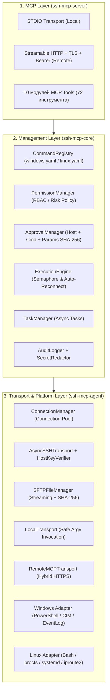

# Техническое задание разработчика: Архитектура и спецификация SSH MCP Server

**Статус:** ✅ Реализовано и верифицировано  
**Версия:** 1.0  
**Дата:** 31 октября 2026  
**Архитектура:** Hybrid (`ssh-mcp-core` + `ssh-mcp-server` + `ssh-mcp-agent`)  
**Платформы:** Windows + Linux (Full Admin с контролируемым повышением привилегий)  
**Updated:** 2026-10-31 17:06:00

---

## 1. Обзор и декомпозиция на 3 компонента

Система реализована в пакете [`ssh_mcp/`](../../ssh_mcp/README.md) и точке входа [`.mcp/ssh_mcp_server.py`](../../.mcp/ssh_mcp_server.py) с чётким разделением на три независимых уровня:

---

## 2. Контракты ключевых классов (`ssh-mcp-core`)

1. **[`CommandRegistry`](../../ssh_mcp/core/command_registry.py):**
   - `register(cmd: CommandDefinition) -> bool`
   - `resolve(command_id: str) -> CommandDefinition`
   - `validate_parameters(command_id: str, provided_params: dict) -> dict`
2. **[`ApprovalManager`](../../ssh_mcp/core/approval_manager.py):**
   - `verify_or_request(host_id, command, parameters, approval_id, actor) -> bool`
   - `approve(approval_id, decided_by) -> bool` / `reject(approval_id, decided_by) -> bool`
   - Криптографическая привязка подтверждения к `host_id`, `command_id` и `SHA-256` канонического JSON параметров.
3. **[`ConnectionManager`](../../ssh_mcp/core/connection_manager.py):**
   - `connect(host_id) -> ConnectionInfo`
   - `disconnect(host_id) -> ConnectionInfo`
   - `reconnect(host_id) -> ConnectionInfo` (с ограничением `max_reconnect_attempts`)
   - `get_transport(host_id) -> BaseTransport`
4. **[`ExecutionEngine`](../../ssh_mcp/core/execution_engine.py):**
   - `dispatch(host_id, command_id, parameters, handler, approval_id, actor) -> dict`
   - Управляет полным циклом: валидация → права → подтверждение → выполнение с семафором `max_parallel_commands` и авто-реконнектом → маскирование секретов → запись в `command_runs` и `audit_log` → возврат `StandardMCPResponse`.

---

## 3. Схема базы данных SQLite (12 изолированных таблиц и репозиториев)

Каждая таблица обслуживается собственным файлом-репозиторием в [`ssh_mcp/storage/repositories/`](../../ssh_mcp/storage/repositories/README.md):

| № | Таблица | Репозиторий | Назначение |
|---|---|---|---|
| 1 | `hosts` | `hosts_repo.py` | Инвентаризация узлов Windows и Linux (`credential_ref` вместо пароля) |
| 2 | `host_credentials` | `host_credentials_repo.py` | Ссылки на провайдеры секретов (`memory_vault`, `env`, `keyfile`, `ssh_key`) |
| 3 | `host_keys` | `host_keys_repo.py` | Доверенные SHA-256 отпечатки публичных ключей SSH-серверов |
| 4 | `connections` | `connections_repo.py` | История и статус активных подключений |
| 5 | `commands` | `commands_repo.py` | Зарегистрированные в `CommandRegistry` команды и их JSON-спецификации |
| 6 | `command_runs` | `command_runs_repo.py` | История выполнения команд (`exit_code`, `duration_ms`, очищенные `stdout`/`stderr`) |
| 7 | `tasks` | `tasks_repo.py` | Длительные асинхронные задачи (`pending`, `running`, `completed`, `cancelled`) |
| 8 | `permissions` | `permissions_repo.py` | Политики доступа к хостам, разрешённые категории и лимит риска |
| 9 | `approvals` | `approvals_repo.py` | Запросы подтверждения для `high` и `critical` операций |
| 10 | `audit_log` | `audit_log_repo.py` | Неизменяемый журнал всех операций с очищенными от секретов деталями |
| 11 | `diagnostics` | `diagnostics_repo.py` | Структурированные пакеты телеметрии `DiagnosticPackage` и `health_score` |
| 12 | `file_transfers` | `file_transfers_repo.py` | История передачи и записи файлов с размером и хэшем `SHA-256` |

---

## 4. Каталог 10 функциональных модулей MCP Tools

1. **Connection Management (`connection.py`):** `ssh_connect`, `ssh_disconnect`, `ssh_reconnect`, `ssh_connection_status`, `ssh_list_connections`, `ssh_test_connection`, `ssh_host_fingerprint`.
2. **Command Execution (`execution.py`):** `ssh_execute`, `ssh_execute_script`, `ssh_execute_batch`, `ssh_execute_async`, `ssh_task_status`, `ssh_task_cancel`.
3. **System Administration (`system.py`):** `system_info`, `system_cpu`, `system_memory`, `system_disks`, `system_uptime`, `system_boot_info`, `system_environment`.
4. **Process Management (`processes.py`):** `process_list`, `process_get`, `process_start`, `process_stop`, `process_tree`, `process_resource_usage`.
5. **Service Management (`services.py`):** `service_list`, `service_status`, `service_start`, `service_stop`, `service_restart`, `service_enable`, `service_disable`.
6. **Filesystem Management (`filesystem.py`):** `fs_list`, `fs_stat`, `fs_read`, `fs_write`, `fs_search`, `fs_copy`, `fs_move`, `fs_delete`, `fs_mkdir`, `fs_chmod`, `fs_chown`.
7. **Network Management (`network.py`):** `network_interfaces`, `network_routes`, `network_connections`, `network_dns`, `network_ping`, `network_port_check`, `network_firewall_status`.
8. **User & Account Management (`users.py`):** `user_list`, `user_get`, `user_create`, `user_modify`, `user_disable`, `user_delete`, `user_groups`, `user_group_add`, `user_group_remove`.
9. **Event & Log Management (`logs.py`):** `logs_list`, `logs_read`, `logs_search`, `logs_export`, `logs_recent_errors`.
10. **Diagnostic & Telemetry (`diagnostics.py`):** `diagnostics_collect`, `diagnostics_hardware`, `diagnostics_os`, `diagnostics_storage`, `diagnostics_network`, `diagnostics_services`, `diagnostics_export`.
